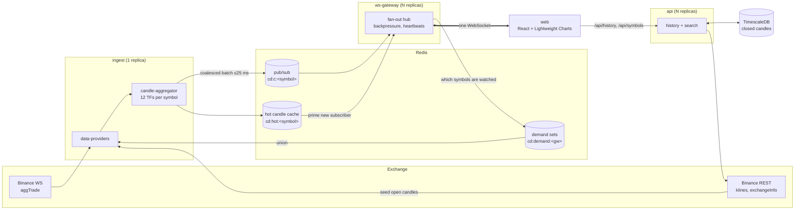

# ChartDeck

Real-time market charting. Raw exchange trades are streamed in, folded into OHLCV candles for
every timeframe on the server, and pushed to the browser over a single WebSocket. Nothing on the
live path polls.

**Status:** Phases 1 (live chart), 2 (indicators) and 3 (drawing tools, accounts) are done.
Workspaces, alerts, scripting and paper trading are next.

## Architecture



**Live path.** `ingest` keeps one combined-stream WebSocket per provider and subscribes to
`<symbol>@aggTrade` only for symbols some gateway is watching. Each trade updates the open candle
of all 12 timeframes. Updates are coalesced (leading-edge throttle, `INGEST_FLUSH_MS`, default
25 ms) and published as one batch per symbol. Each gateway subscribes to a Redis channel once per
symbol, regardless of client count. It serialises each `(symbol, timeframe)` frame once per batch
and writes it to every interested socket.

**Seeding.** When a symbol is first streamed, or after an upstream reconnect, ingest fetches the
exchange's current kline for every timeframe over REST. Live trades are buffered meanwhile, then
replayed past the snapshot time, so the 1D/1W/1M candles open with the exchange's true O/H/L/V.

**Empty intervals.** Binance emits flat, zero-volume klines for seconds with no trades. The
aggregator rolls candles over on a 100 ms timer the same way, so live candles match history.

**History.** `api` serves `/api/history`. The newest page always comes from the provider because
it contains the open candle. Older pages come from TimescaleDB when the cached run is complete
and gap-free; otherwise the provider is queried and the closed candles are written back.
Identical concurrent requests share one upstream call. Binance's request-weight budget is tracked
from its response headers.

**Resilience.**
| Failure | Handling |
|---|---|
| Upstream socket drops | Exponential backoff with jitter; resubscribe; bump the provider *epoch*; re-seed every symbol. Proactive reconnect before Binance's 24 h cut-off. |
| Upstream silently dead | Ping every 15 s, terminate if no pong in 10 s. |
| Browser socket drops | Client backoff (0.5 s → 10 s with jitter), resubscribe, then backfill the gap from REST. |
| Ingest restarts | Epoch changes on every frame; charts see it and backfill. Gateways mark the provider `down` if status goes quiet for 25 s. |
| Slow browser | Above 256 KB buffered, frames are conflated (newest per stream only). Above 4 MB, or after 10 s stalled, the client is disconnected (1013) and reconnects. |
| Half-open TCP | Server pings every 15 s; client app-pings every 5 s and reconnects after 10 s without a pong. |

**Latency measurement.** Every frame carries `et` (exchange event time), `ri` (ingest receive),
`pi` (ingest publish), `xo` (exchange-minus-ingest clock offset) and `sg` (gateway send). The
browser estimates the gateway clock offset from its min-RTT ping. The debug panel (pulse icon in
the top bar) shows p50/p90/p99 per stage, including browser paint.

### Indicators

`packages/indicators` holds 28 indicators, written to Pine Script's conventions. That includes the
seeding (EMA/RMA start from an SMA), Wilder smoothing, and direct ports of Pine's documented
`ta.sar` and `ta.supertrend`. Server-side indicator alerts (Phase 5) will reuse the same package.

| Category | Indicators |
|---|---|
| Moving averages | SMA, EMA, WMA, HMA, VWMA, VWAP (session/week/month anchored, σ bands) |
| Bands & channels | Bollinger Bands, Keltner Channels, Donchian Channels |
| Oscillators | RSI, MACD, Stochastic, Stochastic RSI, CCI, Williams %R, ROC, Momentum, Aroon |
| Volume | OBV, MFI, Chaikin Money Flow, Volume Profile Visible Range (POC, 70% value area) |
| Trend & volatility | ATR, DMI/ADX, Supertrend, Parabolic SAR, Ichimoku (cloud projected forward) |
| Levels | Pivot Points (traditional, Fibonacci, Camarilla; auto/day/week/month) |

**Incremental computation.** Each indicator is a step function over plain-data state. The
`Runner` snapshots state once per new bar; a live tick that revises the open candle restores the
snapshot and re-steps. Each tick therefore costs one step per indicator, whatever the history
length. Full recomputation happens only when history itself changes: load, scroll-back, backfill
or timeframe switch.

**On the chart.**
- Overlays share the price scale. Oscillators get their own resizable panes, with reference
  levels and shaded bands.
- Fills (Bollinger, Ichimoku cloud with bull/bear colouring) and the volume profile are drawn by
  series primitives.
- Add an indicator with the **fx Indicators** button or `/`. Add the same one several times with
  different inputs if you like.
- Legend rows show values at the crosshair, with hide, settings and remove controls. Inputs and
  styles apply live without moving the indicator's pane.
- The indicator set persists in the browser and applies to every symbol.

**Verification.**
- 15 indicators are checked against the independent `technicalindicators` library: SMA, EMA,
  WMA, RSI, Bollinger, MACD, Stochastic, ATR, CCI, %R, MFI, ROC, OBV, ADX, Parabolic SAR.
- The rest have hand-computed cases.
- All 27 bar-based indicators pass a property test: streaming each bar as several live revisions
  must produce exactly the full batch result.

### Drawing tools

| Group | Tools |
|---|---|
| Lines | Trend line (Alt+T), Ray, Arrow, Horizontal line (Alt+H), Vertical line (Alt+V), Parallel channel (Alt+P) |
| Fibonacci | Retracement (Alt+F), Trend-based extension |
| Shapes & text | Rectangle (Alt+R), Text |
| Forecasting & measurement | Long position, Short position (R:R, target/stop %, open P&L), Measure (Alt+M) |

- **Placing.** Click each point, or press-drag-release for two-point tools. One-click tools are
  horizontal/vertical line, text and the position tools.
- **Editing.** Drag handles to edit points, or drag the body to move the whole drawing. The
  floating bar sets colour, width, line style, background, font size, lock and delete.
- **Keyboard.** Double-click a text label to edit it. `Del` deletes the selection, `Esc` cancels
  or deselects, `Ctrl+Z` / `Ctrl+Shift+Z` undo and redo.
- **Magnet** snaps anchors to the displayed bar's O/H/L/C (Heikin Ashi values on an HA chart).
  Time always snaps to a bar.
- **Shared across timeframes.** Drawings belong to the symbol, not the timeframe. Anchors are
  stored as real timestamps, so a line drawn on 1m lands in the right place on 1h. Anchors can
  also extend into the future, past the last bar.
- **Rendering** uses a Lightweight Charts series primitive, in the chart's own paint pass. It
  can't lag behind pan or zoom, and axis labels show for the selected drawing's anchors.
- **Persistence.** Signed out, drawings stay in this browser's localStorage, so they're per
  device. Signed in, they are stored per user per symbol in Postgres and follow you to any device.
  Drawings made while signed out are moved into the account on sign-in.
- **Cross-device refresh.** A signed-in tab re-reads from the server when it regains focus and
  every 30 s while visible. It never does so mid-gesture or over unsaved edits.
- **Saves** are debounced, and payloads are validated on both ends against the shared `Drawing`
  schema (max 500 drawings per symbol).

### Accounts

- **Tokens.** `POST /api/auth/register | login` returns a 15-minute HS256 access token, kept in
  browser memory only. It also sets a 30-day refresh token as an `httpOnly`, `SameSite=Strict`
  cookie scoped to `/api/auth`.
- **Refresh.** `POST /api/auth/refresh` rotates the refresh token. A rotated-out token presented
  again after a 10 s grace window counts as theft and revokes the whole session family. The grace
  window covers two tabs refreshing at once.
- **Logout** revokes immediately.
- **Passwords** are hashed with scrypt (N=2^15). Login takes the same time whether or not the
  email exists.
- **Rate limits.** Register and login are limited to 10/min per IP.
- **Origin checks.** Cookie-authenticated endpoints reject foreign `Origin`s.
- `GET/PUT /api/drawings?symbol=` needs `Authorization: Bearer`.

### Modules

```
packages/
  shared/             wire protocol, timeframes + bucket math, symbol ids (used by server and browser)
  data-providers/     MarketDataProvider interface; binance (REST + WS) and mock adapters
  candle-aggregator/  trades -> open candle for every timeframe; seeding; empty-interval roll-over
  service-kit/        logging (pino), env parsing, /healthz /readyz /metrics
services/
  ingest/             upstream streams -> aggregator -> Redis
  ws-gateway/         client WebSockets, fan-out, backpressure, rate limits, demand registry
  api/                history (read-through TimescaleDB cache) and symbol search
web/                  React + Vite + Zustand + Tailwind; ChartController owns Lightweight Charts,
                      drawings/ holds the drawing engine (tools, DrawingManager, persistence)
deploy/               Dockerfiles, nginx, k8s (kustomize), Prometheus, Grafana dashboard
test/integration/     end-to-end WebSocket flow against real processes + Redis
scripts/              build, dev runner, latency probe
```

## Running

### Everything in Docker

```sh
cp .env.example .env        # optional
docker compose up --build
open http://localhost:3000
```

Add the monitoring stack with `docker compose --profile monitoring up --build`. Grafana runs at
http://localhost:3001 and the *ChartDeck · Live data pipeline* dashboard is provisioned.

### Local development (hot reload)

```sh
npm install
docker compose up -d redis timescale   # Redis on 127.0.0.1:56379, Postgres on 127.0.0.1:55432
npm run dev                            # ingest, ws-gateway, api and Vite on http://localhost:5173
```

If Binance is blocked on your network, set `BINANCE_REST_URL=https://data-api.binance.vision`
and `BINANCE_WS_URL=wss://data-stream.binance.vision`. To work fully offline, set
`PROVIDERS=binance,mock` (or `mock`) and search for `TEST1`.

### Tests

```sh
npm test                    # unit: aggregation, bucket math, history cache, HA/hollow, backpressure, Binance mapping,
                            #       drawing math (fib levels, R:R, measure, hit-testing, time mapping, undo)
npm run test:integration    # WS flow (ingest + ws-gateway, mock provider, Redis :56379) and
                            # accounts/drawings (Postgres :55432)
npm run typecheck
```

### Measuring latency

In the browser, open the debug panel with the pulse icon. From the command line:

```sh
node scripts/latency-probe.mjs ws://localhost:8080/ws binance:BTCUSDT 1s 30   # dev
node scripts/latency-probe.mjs ws://localhost:3000/ws binance:BTCUSDT 1s 30   # docker (through nginx)
```

### Kubernetes (k3s)

```sh
for s in ingest ws-gateway api; do
  docker build -f deploy/docker/service.Dockerfile --build-arg SERVICE=$s -t <registry>/chartdeck/$s:0.1.0 .
done
docker build -f deploy/docker/web.Dockerfile -t <registry>/chartdeck/web:0.1.0 .
# push, then point the `images:` entries in deploy/k8s/kustomization.yaml at <registry>

kubectl create namespace chartdeck
kubectl -n chartdeck create secret generic chartdeck-db --from-literal=password="$(openssl rand -base64 24)"
kubectl -n chartdeck create secret generic chartdeck-auth --from-literal=jwt-secret="$(openssl rand -base64 48)"
# edit ALLOWED_ORIGINS in deploy/k8s/config.yaml and the host in deploy/k8s/ingress.yaml
kubectl apply -k deploy/k8s
```

`ingest` must stay at exactly one replica, since two would publish every candle twice. Gateways
and the API scale horizontally. Pods carry `prometheus.io/*` scrape annotations.

## Adding a data provider

1. Implement `MarketDataProvider` (`packages/data-providers/src/types.ts`) in
   `packages/data-providers/src/<id>/`:
   - `getCandles(ticker, tf, { startTime?, endTime?, limit })` returns ascending candles.
     `endTime` is inclusive on open time.
   - `searchSymbols` / `getSymbol` return `SymbolInfo` with id `<provider>:<ticker>`.
   - `serverTime()` returns the provider clock, used for latency and seeding cut-offs.
   - `openStream(handlers)` returns a `TradeStream`. Call `onTrade` for every trade, `onState` on
     connection changes, and `onReconnected` after any gap, which triggers a re-seed.
     `setTickers` receives the full desired set; diff it and respect upstream rate limits.
   - Set `timeframes` to what the provider can serve history for.
2. Register it in `packages/data-providers/src/registry.ts` and add its env vars to `.env.example`.
   Provider API keys stay server-side; only `ingest` and `api` read them.
3. Add a mapping test like `packages/data-providers/test/binance-search.test.ts`, then enable it with `PROVIDERS=binance,<id>`.

Bucket boundaries come from `packages/shared/src/timeframes.ts`: UTC, with weeks opening on
Monday (the Binance convention). A provider whose sessions differ, such as NSE's 09:15 IST daily
open, needs session-aware bucketing there. That's planned with the NSE adapter.

## Known limitations (Phase 1)

- **Only Binance is implemented.** The NSE/BSE (Upstox / Angel One SmartAPI) and US-equity
  (Finnhub / Alpaca) adapters need API keys to build and test against, so they come once keys are
  available. The interface is ready for them.
- **Exchange → ingest dominates latency** and depends on where ingest runs relative to Binance's
  matching engine (AWS Tokyo). The stage also includes ±RTT/2 error from estimating the exchange
  clock over REST.
- **Seeding volume** can double-count trades from the ~RTT/2 window around the REST snapshot,
  and only in the candle that is open when a symbol starts streaming. Binance klines expose no
  trade ids to dedupe against.
- **Local-time axis** uses one UTC offset for the session, so intraday bars on the far side of a
  DST change are labelled one hour off. Daily and longer bars are always on UTC dates.
- **Scroll-back to listing date**: the deepest page is shorter than the page size, so it is never
  served from cache and always goes to the provider.
- **Drawing sync is last-write-wins per symbol**, refreshed on focus and every 30 s rather than
  pushed live. Two devices editing the same symbol within the same window can overwrite each
  other's latest change.
- **Indicator sets** are saved per browser for now. Saved layouts, synced to the account, come
  with Phase 4.
- **No password reset or email verification.** Both need an outbound mail service, which comes
  with email alerts (Phase 5).
- **Drawings on very different timeframes.** A 1-minute-precise anchor viewed on 1W is placed
  proportionally inside its week bar, but time snapping while editing there rounds it to a bar.
